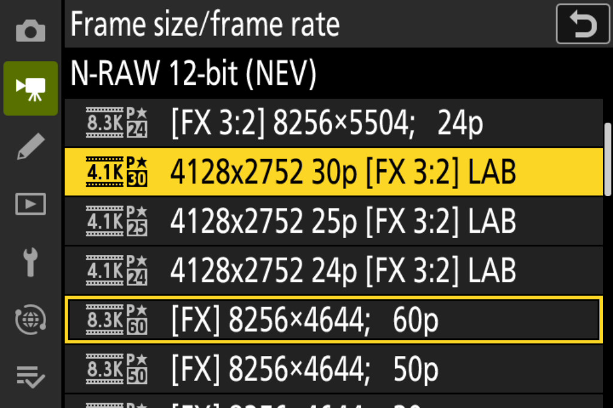

# 4K Open Gate 前端实验原型

该目录包含实际 AArch64 前端原型和独立模拟器构建入口。**它还不是可录制的 4K 固件，也不生成可刷入相机的更新包。** 生产入口 `patch.py`、原有审阅配方和原有 8.3K 功能保持不变。

## 已实现的实验部分

- 从严格匹配审阅配方的 `03.11.p0` 全功能基线生成模拟器 MAIN。
- 主菜单加入 4128×2752 的 30/25/24p LAB 行；保留三个 8.3K Open Gate 行及全部 80 个原厂行。
- 使用既有数据存储事务写入 size=4、rate=4..6、Open Gate 标志，主菜单汇总复用原厂 4.1K 速率/品质资源。
- 配置钩子区分普通模式与实验模式；前端计划类型 11 使用全高半分辨率配置。
- 独立驱动入口覆盖原厂实际到达的 variant=2 和 variant=3，避免只改 D10 的 variant=3 钩子。
- 按字段修改实际几何，保留 1920×1080 代理及取景输出。
- 13 项 Unicorn 测试执行真实 AArch64 机器码，验证边界条件、寄存器、栈、NZCV、普通模式回退和既有 8.3K 路径；另有四项真实输入的构建集成检查。

| 数值 | 在原型中的含义 |
|---|---|
| 4128×2752 | 目标有效区域 |
| 4140×2756 | 全高半分辨率物理输入几何 |
| 4140×2760 | 逻辑传感器范围，不能直接当作编码高度 |
| 4140×2756 | 有界的编码尺寸候选，尚未通过 TICO/文件解码验证 |

新增代码位于 `0x40965000`，与既有 D10 代码及运行时状态区分开。原有代码地址和反挤压接入点保留。`frontend-profile.json` 固定原型源码和机器码 SHA-256；编译结果不匹配时构建拒绝继续。

## 编译与测试

使用支持 `aarch64-none-elf` 的 Clang；编译器适配应在调用端完成，不修改本项目的原厂校验或生产编译单元配方。

```sh
python -m pip install -r requirements-opengate4k-lab.txt

OG4K_COMPILER=/path/to/clang \
OG4K_ORIGINAL=/path/to/original/Z_8_0311.bin \
OG4K_BASELINE=/path/to/reviewed-03.11.p0.bin \
python -B -m unittest discover -s tests

python tools/build_opengate4k_lab.py \
  --original /path/to/original/Z_8_0311.bin \
  --baseline /path/to/reviewed-03.11.p0.bin \
  --compiler /path/to/clang \
  --output build/opengate4k/lab-001
```

输出 `opengate4k-lab-main.bi` 是 81,807,709 字节的模拟器 MAIN，不是 99,051,117 字节的尼康更新包。构建不会封装、签名或提供刷机操作。

## 尚未完成

- i 菜单新增行、取消回滚和菜单库切换的完整集成；不要在原型中用 i 菜单修改画幅。
- 编码尺寸候选、NRMT/NCTG 裁切及尺寸元数据、四档码率预算和剩余时间。
- 回放、缩略图、代理以及反挤压对新文件身份的处理。
- TICO 码流完整解码、真实传感器读出、Bayer 排列、视角和稳定性验证。

## 本轮运行结果（2026-11-12）

实验 MAIN 的 SHA-256 仍为 `e293e2d97e55be35b6399014afb13eebbf6666d3d532cbef83960d98b586a959`。本轮新增的是单独、默认关闭的 QEMU header 控制模型，以及更准确的只读诊断；没有继续修改 MAIN 来绕过设备模型。

后续审查修复了实验模型的轮询调度问题：等待 header 时应先保留原有定时器重排。实际 C 调度前缀的“先等待、稍后就绪”回归已通过。修正模型后重新观察原厂81.4、LAB94.3虚拟秒，两者仍无视频帧或source/ISP确认，原生控制均START/STOP各一次。旧版零帧记录存在调度混杂因素，保留为历史观测；新结果和原始EX菜单核对见 [调度修复证据](../docs/data/opengate4k-header-retry-runtime.json)。当前51项项目测试及9项独立模型/触点测试通过。

| 检查 | 原厂 N-RAW 4.1K 30p | 4K LAB 30p |
|---|---|---|
| 视频快照 | actual8、nominal4、size4、rate4、request4 | 相同 |
| 驱动返回值 | 15 | 14，物理读出未确认 |
| 视频前端 | plan11、4140×2344 | plan11、4140×2756 |
| 有效区域 | 4128×2322 | 4128×2752 |
| header 控制 | START 1次、原生 STOP 1次 | START 1次；短时仍等待，较长观察原生 STOP 1次 |
| 等待释放 / 视频帧 | 0 / 0 | 0 / 0 |
| 视频 source / ISP 确认 | 0 / 0 | 0 / 0 |
| UART 原始异常 / 未建模访问 | 均未出现 | 均未出现 |
| 录像验收 | 未通过，未提交 Record | 未通过，未提交 Record |

两次新增格式读值的有界执行都正常清理了 QEMU，但这只证明设置与控制链路继续向前。原厂观察到切入 Movie 后81.7虚拟秒，LAB 的格式核对观察到23.7虚拟秒；后者仍在等待数据。此前同一 LAB MAIN 与模型的较长运行观察了72.5虚拟秒，已看到原生 STOP，未记录额外的格式读值。三次运行的视频帧及数据就绪释放均为0，不能将观察时长不同造成的控制状态差异当作固件差异。

原生 MAIN 后续配置 source2 和 ISP1；最终 source2 控制、ISP1 配置项0x218及主输入 active 均为0。原模型的完整 video-ready 检查使用 source0，本实验保留该数据检查。照片模式此前产生的238个合成 RAW 帧不属于视频帧，视频 HUD 或残留画面也不能证明取景正在更新。

START 当时的日志捕获到 supplier 已配置1920×1080、pitch5888，且没有照片/编解码所有者或待确认事件。因此先前从结束快照推测的“供应者尚未配置”不成立。新模型只接受已观测的完整四行内部端口控制，锁存后等待原有完整数据条件；不会产生像素、DMA、IRQ 或虚构的完成事件。实现、拒绝位和复跑说明见 [独立 QEMU 实验](../experiments/qemu/README.md)，精简输入及对照结果见 [header 证据](../docs/data/opengate4k-header-runtime.json)。

此前 CAPTG 原始异常已通过相同 MAIN、相同按键的 selector15 A/B 确认：`0x47F5AF4F` 为0会在减一后产生越界记录基址 `0x2A155D78A0`，在 `PC 0x41170D84` 读取 `0x2A156B2806` 时异常；显式合成输入1使记录基址回到 `0xA155D78C0`。后续的 `0x15080014` 访问属于异常诊断转储。这个输入不是恢复的相机校准数据。A/B 的历史证据保留在 [selector 对照](../docs/data/opengate4k-selector-ab.json) 中。

本轮51项项目测试和5项独立模型测试通过。13种拒绝/延后检查状态属于一个 C 合约测试内的条件覆盖，不重复计为13项测试。25p、24p 的固件条件分支已有隔离执行覆盖；完整 QEMU 设置链路当前仅核对30p。下一步是确认 N-RAW 的原生数据源启动与 source2/ISP1 协作，再验证 TICO 及文件链路。

## 复跑设置追踪

后续原始EX已核对原厂N-RAW4.1K30p与Record：EX报告字节9和MAIN的SW1掩码0x2000均捕获按下，source2控制最终为1，日志有三次ISP1 START。视频帧与source/ISP确认仍为0，虚拟卡无影片。直接阻塞点是header等待只检查空的source0，未对齐原生source2/ISP1布局；此外现有secondary模型默认未开启。0x218只是配置项，不能将其为0解释为ISP1未启动。该轮到1200秒墙钟时限正常退出，后追加的Stop/Photo恢复未执行。精简证据和实际63个输入见 [原生Record记录](../docs/data/opengate4k-native-record-runtime.json)。

使用 `WonderLantern/z8-qemu` 的 `d50b07dbaeebae45b2cff936e5bfcd85251ac1fd` 模型、其 QEMU 11.1.1 构建、合成 RAW 输入及专用虚拟卡。下列环境变量只指定显式实验 MAIN；完整原厂和基线身份仍由构建器核验，原有模拟器原厂校验入口保持不变。

```sh
OG4K_STOCK_MAIN=/path/to/stock-main.bi \
OG4K_LAB_MAIN="$PWD/build/opengate4k/lab-001/opengate4k-lab-main.bi" \
OG4K_LAB_SHA256=e293e2d97e55be35b6399014afb13eebbf6666d3d532cbef83960d98b586a959 \
python tools/trace_opengate4k.py \
  --qemu-repo /path/to/z8-qemu \
  --firmware /path/to/stock-main.bi \
  --qemu /path/to/qemu-system-aarch64 \
  --raw /path/to/synthetic-liveview.raw \
  --card /path/to/development-only-exfat.raw \
  --output build/opengate4k/trace-001 \
  --replay docs/data/opengate4k-lab-replay.json --seconds 500 \
  --experimental-shared221 --experimental-boundary-inputs \
  --experimental-sensor-source-clock --experimental-yuv-channels \
  --experimental-movie-selector16 --experimental-movie-selector10
```

按键回放含切换 N-RAW 后的原生提示确认。追踪使用硬件执行断点和只读观测，不注入客体寄存器或运行时 RAM；不会绕过未建模访问错误。生成 `observations.json`、菜单图和原运行器 `result.json`，后者包含完整运行失败原因。若环境不支持 Unix socket，可显式指定自行准备的 `--transport-helper`，它只应改变主机传输。

复跑本轮 A/B 时，两组都使用 `--replay docs/data/opengate4k-selector-replay.json`，指定两个新输出目录和从同一开发虚拟卡复制的独立卡文件。A 使用上述输入，B 额外加 `--experimental-movie-selector15`；必须同时启用完整 Movie profile 和 selector10。两组 MAIN、QEMU、合成 RAW 及按键列表应相同。`result.json` 会保存 `primary_exception`，先查看该字段再解释最后的 MMIO 停止地址。此选项不改变生产固件，也不提供校准参数。

## 模拟器主菜单截图



这是本轮原型 MAIN 真实执行后渲染的菜单，不代表录像或实体机身验收。原有三个 8.3K Open Gate 行在同一列表中保留，图中可见其中的 24p；其余两行位于滚动区域上方。

## 复跑 header 控制对照

先按 [独立模型说明](../experiments/qemu/README.md) 准备专用 QEMU。上面的设置追踪再增加 `--experimental-movie-selector15 --experimental-deferred-video-header`，使用本轮保存的 [LAB 按键](../docs/data/opengate4k-header-lab-replay.json)；原厂对照不设置 `OG4K_LAB_MAIN`，使用 [原厂按键](../docs/data/opengate4k-header-stock-replay.json)。两组必须各自使用新输出目录和独立虚拟卡。追踪会记录 `experimental_header_latch.hardware_model_modified=true`，不能与未改模型的历史 A/B 混淆。

按键回放是只追加的控制文件；创建同名 `.done` 文件可以正常结束有界观察。先检查视频快照的 `file_type=6`（N-RAW）、size/rate，再解释后续事件，避免把其他 RAW 格式或菜单光标位置当作已选择 N-RAW。
